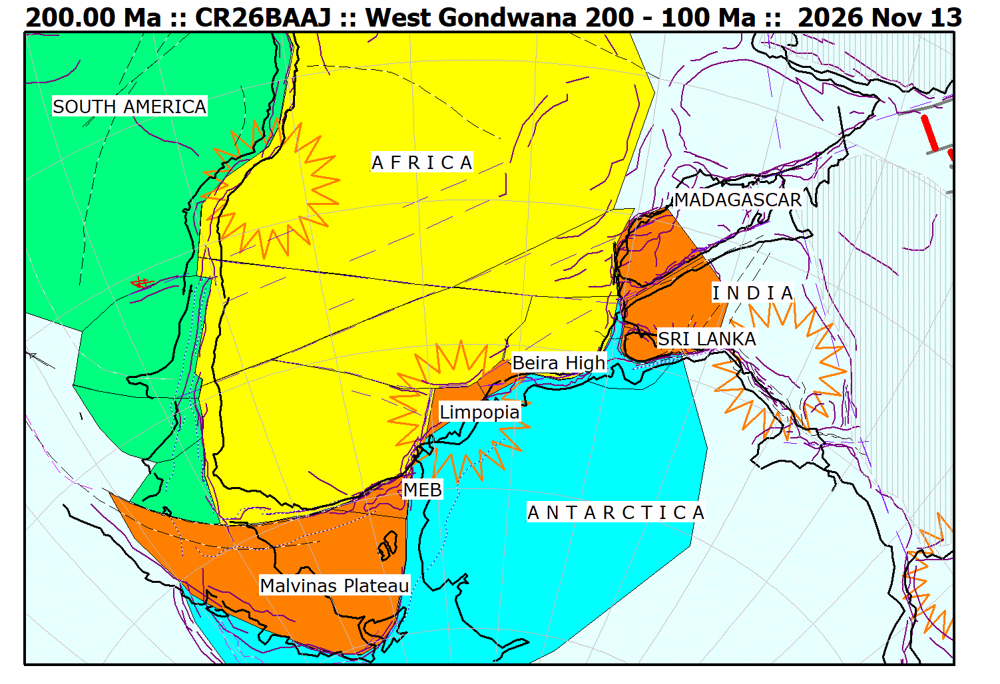

## Where were they in Gondwana? Where are they now?

* [Select another animation](../animations)

When Gondwana split into two parts in Early Jurassic time, East Gondwana was made up of present-day Antarctica, Australia, India, and Madagascar and West Gondwana of Africa and South America.  To fully understand the subsequent splitting of of West Gondwana we cannot ignore Antarctica and the sequence of events around the Bouvet triple junction separating South America, Africa and Antarctica.  This animatuon is designed to demonstrate how our model envisages this in a simple way that presents a credible tectonic hostory of the smaller fragments involved.  The motivation was to explain present-day geography in the simplest possible way.  Our result is consistent with geometry and the rules of plate tectonics, even if some conventional wisdom based on field interpretations is called into question.  Some of these appear to enjoy the freedom of 'hand-waving' while ignoring the rigours of geometry and the processes of ocean growth.  Many predate the detail of ocean-floor topography now available through satellite altimetry on which this interpretation is based.

*Launched 2026 November 16*

* [Select another animation](../animations)
* [Return fo Gondwana main page](../../gondwana)
