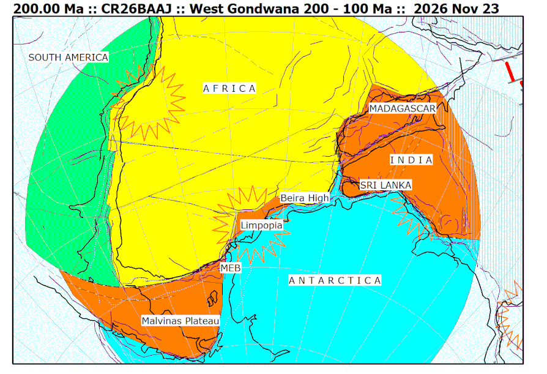

## Where were they in Gondwana? Where are they now?

* [Select another animation](../animations)

When Gondwana split into two parts in Early Jurassic time, East Gondwana was made up of present-day Antarctica, Australia, India, and Madagascar and West Gondwana of Africa and South America.  To fully understand the subsequent splitting of West Gondwana we cannot ignore Antarctica and the sequence of events around the Bouvet triple junction separating South America, Africa and Antarctica.  Geometrically, the [Africa-Antarctica Corridor](https://www.reeves.nl/gondwana/africa-antarctica/) is common to the plate circuits of both East and West Gondwana.

This animatuon is designed to demonstrate how our model envisages West Gondwana disruption in a simple way that presents a credible tectonic history of the smaller fragments involved.  The motivation was to explain present-day geography in the simplest possible way.  Our result is consistent with geometry and the rules of plate tectonics in ocean growth, even if some conventional wisdom based on field interpretations is called into question.  Some of these ideas appear to enjoy the freedom of 'hand-waving' while ignoring the rigours of geometry and the processes of ocean growth.  Many ideas predate the detail of ocean-floor topography now available through satellite altimetry on which this interpretation is primarily based.

Let us start with a continuous brittle Gondwana crust; no overlaps of present-day geology and no gaps that cannot be explained.  At the start of the animation (200 Ma, start Jurassic) the areas that have always been part of South America are coloured green, Africa yellow and Antarctica blue.  Smaller fragments with a less simple tectonic history are are shaded orange.  West of the AAC we have (1) the Malvinas plateau, (2) the Maurice Ewing Bank (MEB), (3) Limpopia and (4) the Beira High. Once a fragment joins one of the three larger plates, it adopts the colour of that continent. East of the AAC we show token parts of East Gondwana, namely (1) Madagascar, (2) India and (3) Sri Lanka, also in orange. All seven fragments move by either strike-slip movement against adjacent fragments or by ocean growth. There is never any overlap or gap and ocean growth never goes into reverse. 

**The Malvinas Plateau** is the largest of the West Gondwana minor fragments, almost as large as peninsular India. Its continental part is everything in South America south of the arc described by the geometrically accurate westward extension of the Agulhas fault in our reassembly.  A defensible fit of the whole of South America to Africa south of the Niger delta does not bring the westward extremity of the Falklands-Agulhas FZ immediately against the Agulhas FZ on Africa. There is a gap of 150-200 km. The Salado and Colorado rifts in Argentina have to be closed in order to eliminate this.  The well-defined North Falklands rift basin is then parallel to the future extension between the Malvinas plateau and the Maurice Ewing Bank.

**The Maurice Ewing Bank** is given a simple triangulat outline.  The northern edge is coincident with the Agulhas FZ, the eastern edge (with prominent escarpment visible in the ocean-floor topography) is part of the 'super-Lebombo' in the reconstruction and the SW margin abutts the Malvinas plateau and is colinear with the Cape Fold Belt in our reconstruction. A DSDP drillhole (DSDP 330) on the MEB encountered crystalline rocks dated at 1100 Ma.  In our reassembly this is an eastward extension of South Africa's Namaqua-Natal belt of the same age. Both the MEB and the Malvinas plateau have escaped the Bouvet plume head and have bceome part of the South America plate (green) by about 100 Ma

**Limpopia** is an invention within this work that is necessary to explain the growth of ocean in the strip about 300 km wide lying immediately west of the AAC. Limpopia is the southernmost part of today's Mozambique Ridge with a distinct lozenge shape and a size comparable with Sri lanka.  The space between it and Antarctica has reduced to zero by reversing ocean growth by about 130 Ma.  This we interpret to mean that earlier ocean growth was further north, between Limpopia and Africa with Limpopia itself retreating northward as part of the Antarctica plate to close the remaining 1100 km of ocean growth before that time.  Much of that early growth of (extended magmatic) crust was left behind on Africa at about 150 Ma and now forms the Mozambqiue plains.  Similarly, almost all the early crust grown between Limpopia and Antarctica was left behind on Antarctica at about 120 Ma.  Both areas of new crust have black hachuring in the diagram. Note the similarity between the movement of Limpopia and that of Sri Lanka in the animation. By contrast, however, Limpopia was always in the vicinity of the Bouvet plume head and so was endowed with a great deal of magmatic material that is not in evidence around Sri Lanka.  Limpopia escapes the plume head by about 120 Ma and remains part of the Africa plate (yellow) after that time.

*Launched 2026 November 17, extended 2026 November 27 *

* [Select another animation](../animations)
* [Return fo Gondwana main page](../../gondwana)
